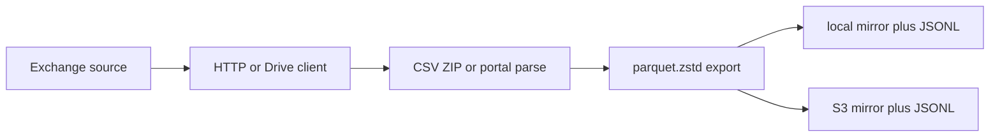
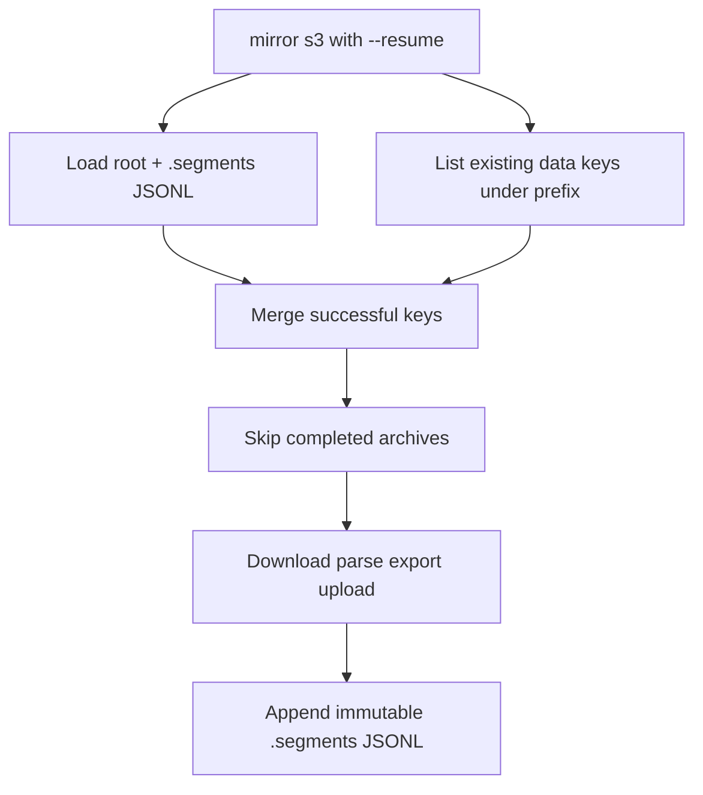

# historical-rs architecture

Monorepo of exchange historical-data pipelines that share the same shape:

Bybit currently implements the S3 path only in Rust (local raw download is a separate Python helper).

## Crates

| Crate | Role |
|-------|------|
| `historical-core` | Progress reporter, `S3Config` + path-style bucket, parameterized S3 manifest writer, `MirrorStatus`, tracing init, HTTP GET retry |
| `binance-vision` | Vision URLs, CHECKSUM, parsers, ClickHouse `binance_vision.*` |
| `binance-vision-cli` | Binary `binance-vision` |
| `kraken-historical` | Drive scrape/confirm/quota, trade column heuristic, quarterly ZIPs (reqwest **cookies**) |
| `kraken-historical-cli` | Binary `kraken-historical` |
| `okx-historical` | CDN URL modules, funding ALL bundle, borrow monthly, optional sqlx symbol cache |
| `okx-historical-cli` | Binary `okx-historical` |
| `bybit-historical` | Portal list/download, Spot/Contract orderbook + trade parse/export, S3 mirror + manifest |
| `bybit-historical-cli` | Binary `bybit-historical` |
| `deribit-historical` | history.deribit.com public trades (BTC/ETH futures), parquet export, S3 mirror + manifest |
| `deribit-historical-cli` | Binary `deribit-historical` |

Exchange crates keep parsers, URL/CDN/Drive/portal builders, row types, convert planners, and CLI command trees **local**. They depend on `historical-core` with feature forwarding (`mirror` / `s3` / `http` as applicable).

## Compatibility invariants

- S3 object keys and manifest paths stay exchange-specific:
  - Binance: `manifest/binance-vision/...` and Vision-shaped `data/` keys
  - Kraken: `historical/manifest/kraken-historical/...`
  - OKX: `historical/manifest/okx-historical/...`
  - Bybit: Spot orderbook keeps `historical/manifest/bybit/orderbook/...` and `historical/data/orderbook/spot/...` (legacy layout); Spot trade and Contract products use `historical/{data,manifest/bybit}/{trade|orderbook}/{spot|contract}/daily/...`
  - Deribit: `historical/data/trade/{currency}/{instrument}/...` and `historical/manifest/deribit/trade/manifest.jsonl`
- Local resume under `~/.data/{binance-vision,kraken-historical,okx-historical}/` where local mirrors exist. Bybit/Deribit Rust mirrors resume from S3 only.
- Env prefixes are not unified across exchanges.
- Binary names (`binance-vision`, `kraken-historical`, `okx-historical`, `bybit-historical`, `deribit-historical`) stay stable for ops scripts and future-host cron wrappers.
- Production posture is **resume-later from S3**: interrupted mirrors re-run with `--resume` (default **true**) against the same bucket; no live backfill assumption on a cleaned VPS.

## Resume flow

If manifest load or data listing fails, exchanges fall back to per-object HEAD checks rather than aborting the whole run.

## Deferred (forever)

These were considered during the monorepo merge and are **not** planned workspace work:

| Item | Disposition |
|------|-------------|
| Cross-exchange parquet schema unification | Deferred forever — exchange row types and S3 layouts stay separate. |
| Wiring OKX `list_history` into the mirror planner | Deferred forever — OKX lane owns planner scope; not a workspace concern. |
| ClickHouse `*_mt` vs live table naming fixes | Deferred forever — Binance/ClickHouse lane owns DDL and ingest naming. |
| Further S3 manifest CAS / distributed locking | Deferred forever — `historical-core` already journals immutable `.segments/` and merges them on read to recover racing root rewrites; stronger cross-process locking is out of scope. |
